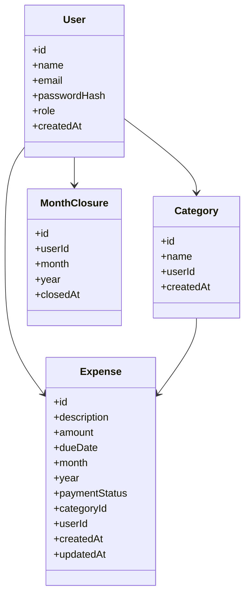

# Controle de despesas pessoais

## Descrição geral
Este projeto é uma aplicação para controlar despesas pessoais, facilitar o acompanhamento por categoria e por mês e impedir alterações em períodos já encerrados. O objetivo é dar a estudantes e jovens adultos mais clareza sobre seus gastos mensais e evitar perdas de controle financeiro.

## Tecnologias e versões
- Node.js 22.23.4
- Express 5.3.0
- Prisma 7.10.0
- PostgreSQL 16 (compatível com projeto local e produção)
- JWT (jsonwebtoken 9.0.3)
- bcryptjs 3.0.3
- React 19.3.1
- Vite 8.3.5
- Tailwind CSS 4.3.0
- react-router-dom 7.18.5
- axios 1.21.0

## Estrutura do repositório
- backend/: API em Express + Prisma + MVC
- frontend/: interface em React + Vite + Tailwind
- docs: coleção de requisições e roteiro de demonstração

## Configuração rápida
1. Configure o PostgreSQL local.
2. Copie `backend/.env.example` para `backend/.env` e ajuste as variáveis.
3. Copie `frontend/.env.example` para `frontend/.env` e ajuste `VITE_API_URL`.
4. No backend, execute:
   - `npm install`
   - `npx prisma migrate dev --name init`
   - `npm run seed`
   - `npm run dev`
5. No frontend, execute:
   - `npm install`
   - `npm run dev`

## Variáveis de ambiente
### Backend
| Nome | Descrição |
|---|---|
| DATABASE_URL | URL de conexão com o PostgreSQL |
| JWT_SECRET | Segredo usado para assinar JWT |
| JWT_EXPIRES_IN | Tempo em que o token expira |
| PORT | Porta do backend |
| CORS_ORIGIN | Origem do frontend permitida |
| NODE_ENV | Ambiente: development ou production |
| SEED_ADMIN_EMAIL | Email do usuário admin de exemplo |
| SEED_ADMIN_PASSWORD | Senha do usuário admin de exemplo |

### Frontend
| Nome | Descrição |
|---|---|
| VITE_API_URL | URL base do backend |

## Rotas principais da API
### Auth
- POST /api/auth/register — cadastro de usuário
- POST /api/auth/login — login e emissão de JWT
- GET /api/auth/me — detalhes do usuário autenticado

### Despesas
- GET /api/expenses — lista despesas com filtros por mês, ano, categoria e status
- GET /api/expenses/:id — detalha uma despesa
- POST /api/expenses — cria despesa
- PUT /api/expenses/:id — atualiza despesa
- PATCH /api/expenses/:id/status — altera status de pagamento
- DELETE /api/expenses/:id — exclui despesa
- GET /api/expenses/summary — resumo por categoria e por status

### Categorias
- GET /api/categories — lista categorias do usuário
- POST /api/categories — cria categoria
- PUT /api/categories/:id — atualiza categoria
- DELETE /api/categories/:id — remove categoria

### Meses
- GET /api/months — lista meses encerrados
- POST /api/months/close — encerra um mês
- DELETE /api/months/:year/:month — reabre um mês

### Usuários (ADMIN)
- GET /api/users — lista usuários
- DELETE /api/users/:id — remove usuário

## Regra de negócio principal
A regra central da aplicação é impedir qualquer criação, alteração ou exclusão de despesas em um mês já encerrado pelo usuário. Sempre que a API identifica um `MonthClosure` para o mês/ano de uma despesa, ela responde com HTTP 409 e mensagem em português: "O mês X/Y já foi encerrado. Não é possível alterar despesas deste período."

## Matriz de permissões
| Recurso | Usuário comum | ADMIN |
|---|---|---|
| Ver despesas próprias | Sim | Sim |
| Criar/editar/excluir despesas próprias | Sim | Sim |
| Ver categorias próprias | Sim | Sim |
| Criar/editar/excluir categorias próprias | Sim | Sim |
| Encerrar/reabrir meses próprios | Sim | Sim |
| Acessar usuários | Não | Sim |
| Excluir usuários | Não | Sim |

## Modelagem do banco

## Componentes de terceiros
- Tailwind CSS — https://tailwindcss.com — MIT License
- Flowbite — https://flowbite.com — MIT License
- HyperUI — https://www.hyperui.dev — MIT License

## Checklist de deploy
1. Criar banco PostgreSQL gerenciado e coletar DATABASE_URL.
2. Publicar backend no Render com diretório `backend`.
3. Comando de build: `npm install && npx prisma generate`.
4. Comando de start: `npx prisma migrate deploy && npm start`.
5. Definir variáveis: DATABASE_URL, JWT_SECRET, JWT_EXPIRES_IN, CORS_ORIGIN, NODE_ENV=production.
6. Publicar frontend na Vercel com root `frontend`.
7. Definir `VITE_API_URL` com a URL pública do backend.
8. Ajustar `CORS_ORIGIN` para a URL final do Vercel.
9. Testar fluxo completo: cadastro → login → despesas → mês encerrado → logout.
10. Para acordar API gratuita do Render, abrir `/health` ou `/api/health` antes da apresentação.

## Roteiro de demonstração
### AV1 (API / Postman)
1. Explicar estrutura MVC, Prisma e banco.
2. Mostrar cadastro e login com hash e JWT.
3. Criar categoria e despesas e verificar persistência no banco.
4. Encerrar um mês e tentar criar ou editar uma despesa no período bloqueado.
5. Validar requisição sem token (401) e tentativa de acesso a dados de outro usuário (403).
6. Demonstrar acesso administrativo com usuário comum (403).

### AV2 (Frontend)
1. Contextualizar problema, público e solução proposta.
2. Realizar cadastro e login na interface.
3. Criar, editar e excluir despesas.
4. Encerrar mês e mostrar bloqueio com mensagem amigável.
5. Verificar sessão expirada e redirecionamento para login.
6. Explicar elementos React + Tailwind e integração com a API.

## Pontos do código para explicar ao professor
- Estrutura MVC: `backend/src/routes`, `backend/src/controllers`, `backend/src/services`.
- Prisma e banco: `backend/prisma/schema.prisma` e `backend/src/config/prisma.js`.
- Validação: `backend/src/validators/*.js`.
- Hash/JWT: `backend/src/services/authService.js` e `backend/src/middlewares/auth.js`.
- Regra de negócio do mês encerrado: `backend/src/services/monthService.js`.
- Tratamento global de erros: `backend/src/middlewares/errorHandler.js`.
- Frontend com autenticação: `frontend/src/contexts/AuthContext.jsx`.
- Rotas protegidas: `frontend/src/routes/ProtectedRoute.jsx` and `frontend/src/routes/AdminRoute.jsx`.
- Interceptador HTTP: `frontend/src/services/api.js`.
- Interface de despesas: `frontend/src/pages/DashboardPage.jsx` e `frontend/src/components/ExpenseTable.jsx`.

## Endereço da aplicação publicada
- Frontend: preencher depois
- Backend: preencher depois

## Roteiro do professor
- O projeto procura resolver o problema de controle de despesas pessoais com organização por categoria e mês.
- A regra de negócio principal impede alterações em meses encerrados.
- A autenticação e autorização são feitas no backend; o frontend apenas complementa as regras com UI e redirecionamentos.

## Arquivos relevantes
- Backend: `backend/src/app.js`, `backend/src/server.js`, `backend/src/services/expenseService.js`, `backend/src/services/monthService.js`.
- Frontend: `frontend/src/App.jsx`, `frontend/src/pages/DashboardPage.jsx`.
- Coleção de testes: `backend/docs/collection.json` e `backend/docs/requests.http`.
